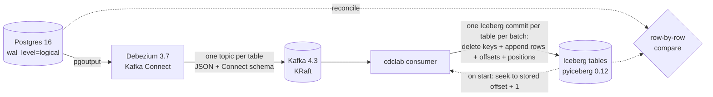

# cdc-lakehouse-lab

[](https://github.com/amritanshagrawal99/cdc-lakehouse-lab/actions/workflows/ci.yml)
[](LICENSE)

**Postgres → Debezium → Kafka → Apache Iceberg, with exactly-once effect.** A change-data-capture pipeline that survives
consumer crashes, Kafka Connect crashes and replays, and still ends with a lake table that matches the source row for row,
column for column. The repo includes the workload that makes CDC hard and the tests that prove it.



## Run it

```bash
docker compose up -d --wait                  # Postgres :55432, Kafka :29092, Connect :18083 (~30 s)
pip install -e ".[dev]"
cdclab setup                                 # source tables
cdclab workload --steps 80                   # rows that will arrive as the initial snapshot
cdclab register                              # Debezium connector, waits until RUNNING
cdclab workload --steps 300                  # the hard cases (below), incl. ALTER TABLE ADD COLUMN mid-stream
cdclab consume --idle-exit 20                # apply to Iceberg (local SQL catalog in ./lake)
cdclab reconcile
# MATCH  public.accounts: 68 rows
# MATCH  public.orders: 29 rows
```

## What makes CDC into a lakehouse hard, and what this does about it

Each item below was verified against the real stack (Postgres 16, Debezium 3.7.0.Final, Kafka 4.3.1, pyiceberg 0.12),
not assumed. Each is covered by a test.

**1. LSNs are not monotonic, so "skip if lsn ≤ watermark" loses data.** Postgres decodes transactions in *commit*
order, but every change keeps its own WAL position. If T1 writes first and commits after T2, T1's changes arrive later
with *lower* LSNs. The workload produces exactly this interleaving. A transaction-id watermark doesn't work either: ids
are assigned at a transaction's first write, not at commit.
→ The consumer's position is the **Kafka offset, stored in the Iceberg commit that applied it**.

**2. Crashing between the Iceberg commit and the Kafka commit.** Each table's batch is one Iceberg transaction. It
deletes the touched keys, appends their final rows, and sets `cdclab.offset.<topic>.<partition>` as a table property. On
start, every partition seeks to that offset + 1. Kafka's consumer-group offsets are committed for lag monitoring only,
and nothing reads them back.
→ `test_consumer_crashes_and_resumes_exactly_once` kills the consumer three times, right after an Iceberg commit and
before its Kafka commit, and the result still matches exactly.

**3. Debezium is at-least-once.** After a Kafka Connect crash, Debezium resumes from its last flushed offset and
re-emits events at **new** Kafka offsets, so offsets alone can't catch them. Re-applying them is usually harmless
(last-writer-wins), but not when an unchanged TOAST value is filled from current lake state (item 5).
→ A per-partition high-water mark on Debezium's `source.sequence` = `(lastCommitLsn, lsn)` is stored with the offsets.
That pair never decreases in emission order, so a replayed event is at or below the mark stored *before its batch* and
is dropped. Ties inside a batch pass, because both halves of a primary-key change share one position, and the batching
rule below keeps those halves in one batch. Snapshot reads (`op=r`) have no position and bypass the filter.
→ `test_kafka_connect_crash_replays_are_absorbed` SIGKILLs Kafka Connect mid-workload. In a typical run, about 300
replayed events are dropped and the tables still match.

**4. pyiceberg's defaults work against exactly-once.**
- Its built-in commit retry rebases a stale write onto the new head. Two writers inserting the same new key produced a
  **silent duplicate**.
- A commit that only sets table properties is not fenced, so a stale writer could **roll stored offsets back**.

→ Tables are created with `commit.retry.num-retries=0`. Every apply includes an append (even an empty one), because an
append creates a snapshot and is therefore fenced. The applier keeps no offsets in memory: each attempt loads the table,
reads offsets and positions from *that* snapshot, and commits against it. If another writer got in between, the commit
fails (`CommitFailedException`, or `ValidationException`, which is not a subclass) and the attempt starts over from a
fresh load. A stale in-memory copy of the offsets could otherwise apply a batch twice.

**5. TOAST placeholders.** An update that doesn't touch a large (TOASTed) column doesn't send it, and Debezium emits
`__debezium_unavailable_value` instead. Writing that literally corrupts the lake.
- The value is filled from an earlier event in the batch, or read from the lake.
- **Primary-key changes** make it harder. Debezium emits `delete(old key)` + `create(new key)`, and the create still
  carries the placeholder, while the real value lives under the *old* key. The `__debezium.oldkey` header names it.
- A batch boundary must never split that pair. Every poll therefore holds back its trailing source transaction until
  more records arrive, or until a poll comes back empty (Debezium emits a transaction's events together, so an idle
  poll means the held transaction is complete). The one exception: a delete carrying `__debezium.newkey` is never
  applied without its create half, however long that takes. As a side effect each source transaction lands in one
  commit per table.

**6. Schema evolution.**
- `ALTER TABLE ... ADD COLUMN` shows up in the next event's Connect schema and is added with `union_by_name`.
- pyiceberg's `upsert` then fails for existing keys (apache/iceberg-python#3105). It also stops pruning files for key
  lists longer than 200. So rows are applied as `delete(In-chunks of ≤ 200) + append`.
- `ADD COLUMN ... DEFAULT x` gives every existing *source* row `x`, but Debezium emits nothing for those rows. The sink
  backfills `x` into existing lake rows, and into rows whose last event predates the column.
- Debezium exports *function* defaults such as `now()` as the epoch. Those are not trusted.

**7. Defaults that silently diverge.**
- Debezium skips `TRUNCATE` unless `skipped.operations=none`.
- JsonConverter's `replace.null.with.default=true` turns real NULLs into column defaults.

→ Both are set explicitly in [connector.json](connector.json). Truncate is handled as "empty the table, then apply the
rest of the batch".

**8. A crashed consumer is still a group member.** It never leaves the group, so Kafka keeps its partitions until the
session times out (45 s by default).
→ `session.timeout.ms=10000`. The idle-exit timer only starts once partitions are assigned.

## Tests

| Suite | What it proves |
|---|---|
| `tests/test_events_compact.py` | Exact decoding of Connect logical types (decimal bytes, micro/milli/zoned timestamps, dates, times), compaction rules, TOAST, PK changes, function-default guard |
| `tests/test_sink_applier.py` | Against a real Iceberg catalog: atomic batches, crash mid-transaction leaves nothing, idempotent replay, out-of-order LSNs, truncate, TOAST from lake and from an old key, schema evolution incl. #3105 and default backfill, >200-key deletes, commit-conflict retry, replay filter |
| `tests/test_review_findings.py` | Regressions from adversarial review: truncate-only batches, truncate replays, replay of the last PK-change pair, stale writers, interleaved-transaction positions, bytea/array placeholders, time columns, duplicate keys in reconcile, transaction-aligned batching |
| `tests/test_e2e.py` (Docker, CI) | The real stack: snapshot → streaming → reconcile; consumer killed 3× → reconcile; Kafka Connect SIGKILLed mid-workload → replays dropped → reconcile |

```bash
pytest -q                                                        # unit tests, no Docker
docker compose up -d --wait && CDCLAB_E2E=1 pytest -q tests/test_e2e.py
```

## Limitations

- **One writer per table.** Two consumers of the same topic are detected (commit conflict, then retry), but this isn't
  designed as a multi-writer sink.
- **No multi-table atomicity.** Each table is exactly-once on its own; pyiceberg has no multi-table transactions.
- **Copy-on-write.** pyiceberg 0.12 rewrites every data file that contains a touched key. Partition or bucket by key and
  compact for real volumes.
- **Re-snapshots don't carry deletes.** If the replication slot is lost and the connector re-snapshots, rows deleted in
  the meantime survive in the lake. The stored positions must also be reset, because LSN continuity breaks.
- **`REPLICA IDENTITY FULL` is the safer production setting.** Debezium then fills unchanged TOAST values itself. The lab
  keeps `DEFAULT` deliberately, to exercise the hard path.
- **Not handled yet:** NUMERIC `NaN`/`Infinity`, and tables without a primary key (rejected with a clear error).

## License

[MIT](LICENSE)
