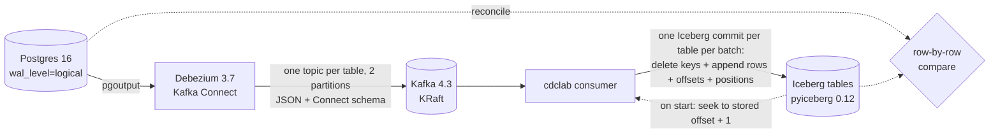

# cdc-lakehouse-lab

[](https://github.com/amritanshagrawal99/cdc-lakehouse-lab/actions/workflows/ci.yml)
[](LICENSE)

**Postgres → Debezium → Kafka → Apache Iceberg, with exactly-once effect.** A change-data-capture pipeline that survives
consumer crashes, Kafka Connect crashes and replays, and still ends with a lake table that matches the source row for row,
column for column. The repo includes the workload that makes CDC hard and the tests that prove it.



## Run it

```bash
docker compose up -d --wait                  # Postgres :55432, Kafka :29092, Connect :18083 (~30 s)
pip install -e ".[dev]"
cdclab setup                                 # source tables
cdclab workload --steps 80                   # rows that will arrive as the initial snapshot
cdclab register                              # Debezium connector, waits until RUNNING
cdclab workload --steps 300                  # the hard cases (below), incl. ALTER TABLE ADD COLUMN mid-stream
cdclab consume --idle-exit 20                # apply to Iceberg (local SQL catalog in ./lake)
cdclab reconcile
# MATCH  public.accounts: 78 rows
# MATCH  public.orders: 26 rows
# MATCH  public.edge_types: 19 rows
```

`edge_types` carries the values that break naive pipelines: `±infinity` timestamps and dates, arrays (one of them large
enough to be TOASTed), `jsonb`, `uuid`, `real`, and two `ALTER COLUMN ... TYPE` widenings mid-stream.

## What makes CDC into a lakehouse hard, and what this does about it

Each item below was verified against the real stack (Postgres 16, Debezium 3.7.0.Final, Kafka 4.3.1, pyiceberg 0.12),
not assumed. Each is covered by a test.

**1. LSNs are not monotonic, so "skip if lsn ≤ watermark" loses data.** Postgres decodes transactions in *commit*
order, but every change keeps its own WAL position. If T1 writes first and commits after T2, T1's changes arrive later
with *lower* LSNs. The workload produces exactly this interleaving. A transaction-id watermark doesn't work either: ids
are assigned at a transaction's first write, not at commit.
→ The consumer's position is the **Kafka offset, stored in the Iceberg commit that applied it**.

**2. Crashing between the Iceberg commit and the Kafka commit.** Each table's batch is one Iceberg transaction. It
deletes the touched keys, appends their final rows, and sets `cdclab.offset.<topic>.<partition>` as a table property. On
start, every partition seeks to that offset + 1. Kafka's consumer-group offsets are committed for lag monitoring only,
and nothing reads them back.
→ `test_consumer_crashes_and_resumes_exactly_once` kills the consumer three times, right after an Iceberg commit and
before its Kafka commit, and the result still matches exactly.

**3. Debezium is at-least-once.** After a Kafka Connect crash, Debezium resumes from its last flushed offset and
re-emits events at **new** Kafka offsets, so offsets alone can't catch them. Re-applying them is usually harmless
(last-writer-wins), but not when an unchanged TOAST value is filled from current lake state (item 5).
→ A per-partition high-water mark on Debezium's `source.sequence` = `(lastCommitLsn, lsn)` is stored with the offsets.
That pair never decreases in emission order. A replayed event is therefore at or below the mark stored *before its
batch*, or strictly below a position already seen *in* its batch (the replay began mid-batch). Either way it is
dropped. Ties inside a batch pass, because both halves of a primary-key change share one position, and the batching
rule below keeps those halves in one batch. Snapshot reads (`op=r`) have no position and bypass the filter.
→ `test_kafka_connect_crash_replays_are_absorbed` SIGKILLs Kafka Connect mid-workload. In a typical run, about 300
replayed events are dropped and the tables still match.

**4. pyiceberg's defaults work against exactly-once.**
- Its built-in commit retry rebases a stale write onto the new head. Two writers inserting the same new key produced a
  **silent duplicate**.
- A commit that only sets table properties is not fenced, so a stale writer could **roll stored offsets back**.

→ Tables are created with `commit.retry.num-retries=0`. Every apply includes an append (even an empty one), because an
append creates a snapshot and is therefore fenced. The applier keeps no offsets in memory: each attempt loads the table,
reads offsets and positions from *that* snapshot, and commits against it. If another writer got in between, the commit
fails (`CommitFailedException`, or `ValidationException`, which is not a subclass) and the attempt starts over from a
fresh load. A stale in-memory copy of the offsets could otherwise apply a batch twice.

**5. TOAST placeholders.** An update that doesn't touch a large (TOASTed) column doesn't send it, and Debezium emits
`__debezium_unavailable_value` instead. Writing that literally corrupts the lake.
- The value is filled from an earlier event in the batch, or read from the lake.
- **Primary-key changes** make it harder. Debezium emits `delete(old key)` + `create(new key)`, and the create still
  carries the placeholder, while the real value lives under the *old* key. The `__debezium.oldkey` header names it.
- A batch boundary must never split that pair. Every poll therefore holds back its trailing source transaction until
  more records arrive, or until a poll comes back empty (Debezium emits a transaction's events together, so an idle
  poll means the held transaction is complete). The one exception: a delete carrying `__debezium.newkey` is never
  applied without its create half, however long that takes. That holds however the batch was cut: a poll that filled
  up, a flush on an idle poll, or several partitions in one poll. Applied alone, the delete would store the pair's
  shared position, and the create would then be dropped as a replay. As a side effect each source transaction lands in
  one commit per table.

**5b. With several partitions, the two halves of a key change are in different partitions.** Debezium routes each
event by its key, so the old key and the new key usually hash to different partitions. The first version paired the
halves within one partition and compacted a batch in (partition, offset) order. On the live stack with 2 partitions,
the consumer then failed on its first batch, on every retry: a create (copying TOAST values from the old row) was
compacted before the insert of that old row, which sat in the other partition.
→ Replays are still filtered in offset order per partition, the only order in which they show. Compaction then runs
in **commit order across partitions**: snapshot rows first, then Debezium's `(lastCommitLsn, lsn)`, with the delete
before the create on a tie. The two halves are matched **by key, per topic**, and **each waits for the other**.
The delete waits for its create, which `__debezium.oldkey` names, in any partition. The create waits for its delete
too: partitions are consumed at different rates, and on the live stack the create of key 95 arrived before partition 0
had delivered the insert of its old key 34, so there was no old row to copy from. Once the delete has arrived,
everything before it in the old key's partition has too. And the batch must be **closed** under pairing: a second
live failure came from judging pairs over the whole list, then cutting at an unrelated unpaired half that fell between
a create and its delete. The cut is now repeated on the prefix until every pair in it is complete.
A third failure surfaced only after a Kafka Connect SIGKILL, in CI. Both halves were in Kafka twice, original and
replay. The replayed create came in early and was consumed with the original pair. The replayed delete then had no
partner left and held back every later record, in every table. So halves are matched by **(key, Debezium position)**,
which identifies one key change. A half at or below its partition's stored position is a replay the applier drops
anyway, so it waits for nothing. And a second delete of an already-deleted key in one batch (a replay) no longer
erases the row state that the create copies from. The lab's topics have 2 partitions, so every end-to-end test runs
this path.

**6. Schema evolution.**
- `ALTER TABLE ... ADD COLUMN` shows up in the next event's Connect schema and is added with `union_by_name`.
- pyiceberg's `upsert` then fails for existing keys (apache/iceberg-python#3105). It also stops pruning files for key
  lists longer than 200. So rows are applied as `delete(In-chunks of ≤ 200) + append`.
- `ADD COLUMN ... DEFAULT x` gives every existing *source* row `x`, but Debezium emits nothing for those rows. The sink
  backfills `x` into existing lake rows, and into rows whose last event predates the column.
- Debezium exports *function* defaults such as `now()` as the epoch. Those are not trusted.
- `ALTER COLUMN ... TYPE` keeps the column name, so it is detected by type: a source type the lake column can't hold
  is widened in place where Iceberg allows it (int → long, float → double, decimal precision). Before that, values over
  2³¹ crashed the batch on every retry. Changes Iceberg can't apply stop the consumer with an error naming the column,
  before anything is written. These are a decimal *scale* change, which `union_by_name` would silently ignore, a
  different type family (e.g. a column dropped and re-added as `int`), and `timestamp` ↔ `timestamptz`.

**7. Defaults that silently diverge.**
- Debezium skips `TRUNCATE` unless `skipped.operations=none`.
- JsonConverter's `replace.null.with.default=true` turns real NULLs into column defaults.

→ Both are set explicitly in [connector.json](connector.json). Truncate is handled as "empty the table, then apply the
rest of the batch".

**8. A crashed consumer is still a group member.** It never leaves the group, so Kafka keeps its partitions until the
session times out (45 s by default).
→ `session.timeout.ms=10000`. The idle-exit timer only starts once partitions are assigned.

**9. Debezium's encodings are not always what the docs say.** All of these were observed on Debezium 3.7.0.Final:
- JsonConverter names `real` / `double precision` as `float` / `double`, not `float32` / `float64`.
- `±infinity` arrives as a sentinel that differs by type. Microsecond timestamps use `Long.MAX/MIN`. Millisecond
  timestamps use the documented `9223372036825200000`. `timestamptz` uses the strings `"infinity"`. Dates use one pair
  of day counts when streaming and *another* in the initial snapshot, where `+infinity` comes out as a large negative
  number.

→ Each sentinel maps to `datetime.max` / `datetime.min` (or `date.max` / `date.min`), and reconcile loads the source the
same way. Any other out-of-range value raises rather than being clamped. Arrays become Iceberg lists, and their TOAST
placeholder (a one-element list) is filled like any other.

## Table maintenance

Every consumer batch adds a snapshot, and copy-on-write deletes rewrite each file that holds a touched key. A CDC table
therefore piles up small files, snapshots and unreferenced files quickly. `cdclab maintain` cleans up and is safe to run
while the consumer is writing:

```bash
cdclab maintain --dry-run                        # what it would do
cdclab maintain                                  # compact at 32+ files, expire snapshots > 24 h (keep the last 10),
                                                 # delete unreferenced files older than 60 min
```

| Step | Why it can't break exactly-once (each point verified in `tests/test_maintain.py`) |
|---|---|
| **Compact** (one overwrite) | It reads snapshot S and commits only if the table is still at S. A consumer commit in between makes it fail, and the run just skips compaction. |
| **Expire snapshots** | Offsets and positions are table *properties*, not snapshot data. A consumer commit built on a view from before the expiry still succeeds. |
| **Delete orphans** | pyiceberg's expiry deletes no files itself (checked), so this is where disk space comes back. A file is kept if any remaining snapshot, manifest, manifest list or metadata file references it, or if it's younger than the grace period, since an uncommitted write may own it. |

The end-to-end test maintains the lake (no grace period, consumer stopped), then streams more changes, and still
reconciles exactly.

## Tests

| Suite | What it proves |
|---|---|
| `tests/test_events_compact.py` | Exact decoding of Connect logical types (decimal bytes, micro/milli/zoned timestamps, dates, times), compaction rules, TOAST, PK changes, function-default guard |
| `tests/test_sink_applier.py` | Against a real Iceberg catalog: atomic batches, crash mid-transaction leaves nothing, idempotent replay, out-of-order LSNs, truncate, TOAST from lake and from an old key, schema evolution incl. #3105 and default backfill, >200-key deletes, commit-conflict retry, replay filter |
| `tests/test_review_findings.py` | Regressions from adversarial review: truncate-only batches, truncate replays, replay of the last PK-change pair, stale writers, interleaved-transaction positions, bytea/array placeholders, time columns, duplicate keys in reconcile, transaction-aligned batching |
| `tests/test_review_v2.py` | Second review: type widening and refused type changes, infinity sentinels (snapshot and streaming), arrays and their TOAST placeholder, replays that start mid-batch, PK-change pairs split by a full poll (driving the real `run()` loop with a fake Kafka consumer), seek-on-assign, real commit fencing without mocks, exact float comparison in reconcile |
| `tests/test_multi_partition.py` | Two partitions: a key change whose halves are in different partitions, in one batch and split across polls (through the real `run()` loop); a create waiting for a lagging old-key partition; batches closed under pairing; commit order across partitions |
| `tests/test_maintain.py` | Maintenance interleaved with the real Applier: data, offsets and positions unchanged; a stale compaction is rejected; every referenced file survives (checked on disk, because pyiceberg caches manifest lists in memory); young files kept; dry run changes nothing; keep-last-N |
| `tests/test_e2e.py` (Docker, CI) | The real stack: snapshot → streaming → reconcile; consumer killed 3× → reconcile; Kafka Connect SIGKILLed mid-workload → replays dropped → reconcile; maintenance, then more changes → reconcile |

```bash
pytest -q                                                        # unit tests, no Docker
docker compose up -d --wait && CDCLAB_E2E=1 pytest -q tests/test_e2e.py
```

## Limitations

- **One consumer per table, however many partitions.** A single consumer handles N partitions correctly (5b). Two
  consumers splitting a topic's partitions cannot work with primary-key changes under `REPLICA IDENTITY DEFAULT`. The
  two halves usually go to different consumers, and the delete's consumer would wait forever for a create it never
  receives. Concurrent commits to the same table are still fenced (conflict, then retry), so a second consumer can't
  corrupt data, only stall. Scale out across tables, not within one.
- **Truncate with several partitions** is ordered against the events of its own batch only. A truncate must be
  applied after every partition has caught up to it, which the lab doesn't enforce.
- **No multi-table atomicity.** Each table is exactly-once on its own; pyiceberg has no multi-table transactions.
- **Copy-on-write.** pyiceberg 0.12 rewrites every data file that contains a touched key. Partition or bucket by key for
  real volumes. `cdclab maintain` compacts by rewriting the whole table, so tables over 2 GiB are skipped (use Spark's
  `rewrite_data_files`). Orphan cleanup supports local warehouses only.
- **Re-snapshots don't carry deletes.** If the replication slot is lost and the connector re-snapshots, rows deleted in
  the meantime survive in the lake. The stored positions must also be reset, because LSN continuity breaks.
- **`REPLICA IDENTITY FULL` is the safer production setting.** Debezium then fills unchanged TOAST values itself. The lab
  keeps `DEFAULT` deliberately, to exercise the hard path.
- **NUMERIC `NaN` must be kept out of the source.** Postgres accepts `NaN` in any `NUMERIC` column, but Debezium's
  precise decimal mode can't represent it: the connector task logs *"Got a special value (NaN/Infinity) for Decimal
  type ... set decimal handling mode to 'string'"*, emits null for a `NOT NULL` field, fails, and fails again on every
  restart because the same WAL record is replayed. (Tried on the live stack; recovery meant recreating the slot.) The
  lab's tables carry `CHECK (balance <> 'NaN'::numeric)`. `Infinity` can't happen in a `NUMERIC(p, s)` column at all.
  The alternative is `decimal.handling.mode=string`, which trades exact types for strings in the lake.
- **Tables without a primary key** are rejected with a clear error.
- **`DROP COLUMN` is not propagated.** The lake keeps the column: rows written afterwards get NULL, older rows keep their
  last value. Reconcile only compares the source's columns, so it doesn't flag this.
- **`±infinity` becomes the largest / smallest Python value.** A real `9999-12-31 23:59:59.999999` is indistinguishable
  from `infinity` in the lake.
- **Not supported:** nested arrays, `map` types, `NUMERIC` without a scale (`VariableScaleDecimal`). Each fails with an
  error naming the column.

## License

[MIT](LICENSE)
